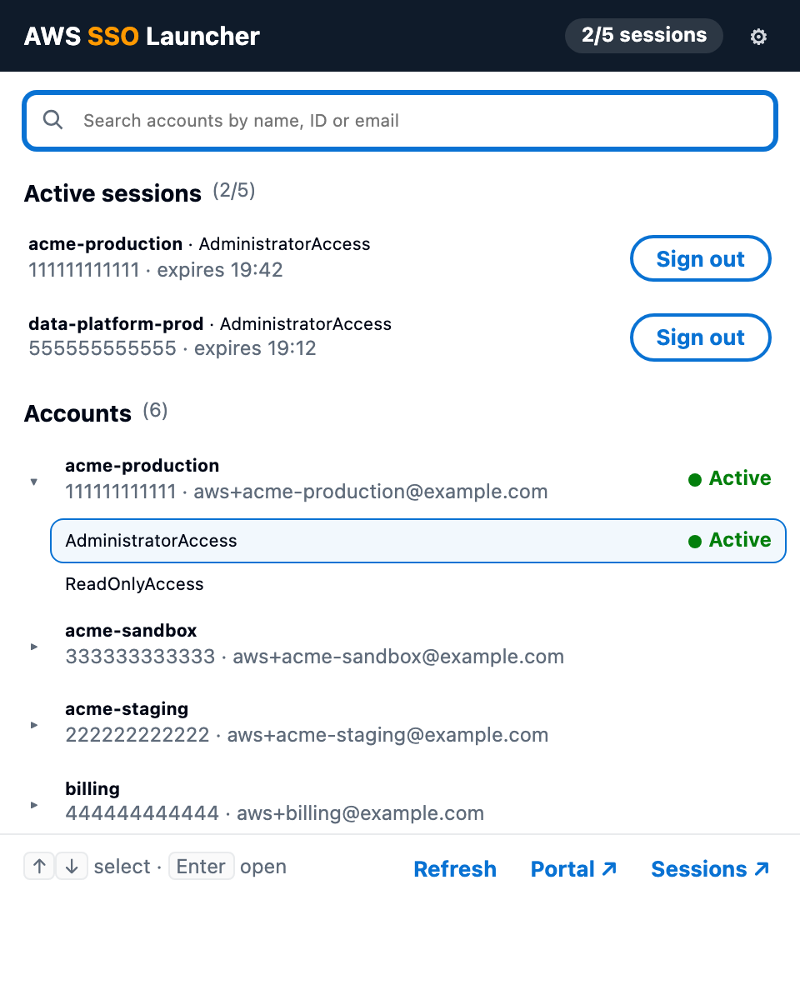
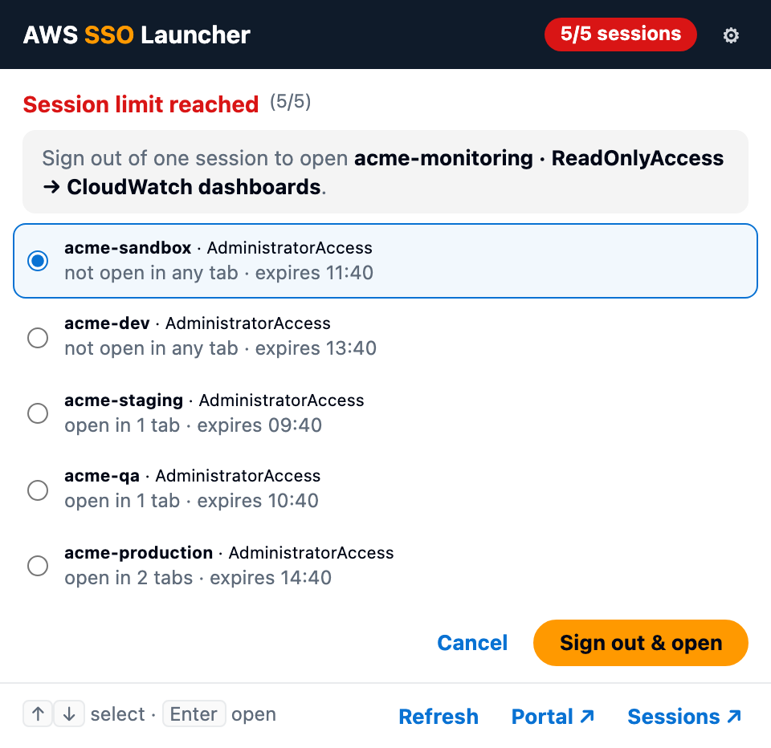

#  AWS SSO Launcher

A small Chrome / Microsoft Edge extension for people who live in AWS IAM Identity Center (AWS SSO). Press <kbd>Alt</kbd>+<kbd>Shift</kbd>+<kbd>A</kbd> (or click the icon), type a few letters of an account, pick a permission set, press <kbd>Enter</kbd>: you're in the console.



- **Search every account** assigned to you, by name, ID or email (all words must match). Open an account to see its permission sets: they're fetched only then, so even large organizations load in one call. When your search matches a single account, its permission sets show up right away.
- **Pin an account + permission set** for one-click sign-in: pins stay in a **Pinned** section at the top (synced across your browsers). While a pin has an active session, it is listed under the session instead.
- **Stable links to console pages**: console URLs contain your session and break when it ends. On a console page, the launcher's **This page** card copies a stable link (the access portal's [shortcut link](https://docs.aws.amazon.com/singlesignon/latest/userguide/createshortcutlink.html) for that account, permission set and page), bookmarks it, or pins the page. Right-click a console page or link → **Copy stable AWS link** does the same from the page.
- **Reuses your sessions**: if you already have a console session for that account and permission set (marked **Active**), <kbd>Enter</kbd> takes you back to it instead of opening a new one, so it doesn't use one of your session slots. Stable links (pinned pages, bookmarks, links from teammates) do the same: if you have a session for that account and permission set, they open the page in it.
- **Console sessions at a glance**: AWS allows 5 simultaneous [console sessions](https://docs.aws.amazon.com/awsconsolehelpdocs/latest/gsg/multisession.html) per browser. The icon badge shows how many are active (orange at 4, red at 5), and the launcher lists them with a **Sign out** button so you can free a slot before you hit the limit.
- **No surprise at the session limit**: when all 5 sessions are used and you open something that needs a new one, the launcher asks which session to sign out of first, suggesting one you have no tab open for (then the one expiring soonest). Rows that would need a new session are marked **Limit reached**.

  

## Install

The extension isn't on the Chrome Web Store / Edge Add-ons yet; load it unpacked:

1. Download or clone this repository:
   ```bash
   git clone https://github.com/clementdenis/aws-sso-launcher.git
   ```
2. Open `chrome://extensions` (Chrome) or `edge://extensions` (Edge) and turn on **Developer mode**.
3. Click **Load unpacked** and select the cloned folder.
4. Pin the extension to the toolbar to see the session count.

Requires Chrome or Edge 116 or newer.

## Setup

On first open, the launcher asks for:

- **Access portal prefix**: the `<prefix>` in your portal URL `https://<prefix>.awsapps.com/start`.
- **Console sign-in region**: the region used to read your console sessions (default `us-east-1`; the field suggests every AWS region).

**Find it in my browsing history** fills both in for you: it looks for the portals (`<prefix>.awsapps.com`) and sign-in regions (`<region>.signin.aws.amazon.com`) you visit most. It asks for the history permission only when you click it.

Change them later with ⚙. Your accounts load once you're signed in to the access portal (the launcher offers a **Sign in** button when you aren't).

## Usage

| Action | How |
| --- | --- |
| Open the launcher | Click the toolbar icon, or <kbd>Alt</kbd>+<kbd>Shift</kbd>+<kbd>A</kbd> (<kbd>⌥</kbd><kbd>⇧</kbd><kbd>A</kbd> on macOS) |
| Find an account | Type to filter, <kbd>↑</kbd> <kbd>↓</kbd> to select |
| Show its permission sets | <kbd>Enter</kbd>, <kbd>→</kbd> or click (<kbd>←</kbd> folds it back) |
| Open the console | <kbd>Enter</kbd> or click on a permission set or an active session |
| Pin / unpin a permission set | The ☆ at the end of its row, in an opened account or on an active session (shown on hover or when selected) |
| Pin the current console page | ☆ in the **This page** card |
| Stable link to the current console page | **This page** card: **Copy link**, **Bookmark** (in an *AWS* bookmarks folder) or ☆; or right-click → **Copy stable AWS link** (the icon flashes ✓) |
| Collapse / expand a section | Click its heading (remembered; search always shows every section's matches) |
| Copy an account ID | The copy icon next to it, or select the row and press <kbd>⌘</kbd>+<kbd>C</kbd> / <kbd>Ctrl</kbd>+<kbd>C</kbd> |
| At 5/5 sessions, open something new | Pick the session to sign out of (<kbd>↑</kbd> <kbd>↓</kbd>), then **Sign out & open** or <kbd>Enter</kbd>; <kbd>Esc</kbd> goes back |
| Sign out of a console session | **Sign out** next to the session, or select it and press <kbd>Delete</kbd> (<kbd>fn</kbd>+<kbd>⌫</kbd> on a Mac, or <kbd>⌫</kbd> when the search box is empty) |
| Reload your account list | **Refresh** (it is also refreshed each time the launcher opens) |
| Change the shortcut | `chrome://extensions/shortcuts` or `edge://extensions/shortcuts` |

## How it works and why it needs its permissions

- **`cookies`** and host access to **`*.awsapps.com`**: once you sign in, the access portal keeps a login token in a cookie. The extension reads it to call the portal API.
- Host access to **`*.amazonaws.com`**: the [IAM Identity Center portal API](https://docs.aws.amazon.com/singlesignon/latest/PortalAPIReference/Welcome.html) (`ListAccounts`, `ListAccountRoles`) that lists your accounts, and an account's permission sets when you open it.
- Opening an account uses the portal's documented [shortcut links](https://docs.aws.amazon.com/singlesignon/latest/userguide/createshortcutlink.html) (`https://<prefix>.awsapps.com/start/#/console?account_id=…&role_name=…`).
- Host access to **`*.aws.amazon.com`**: the console session list and sign out. They use the same endpoints as AWS's own session limit page:
  `GET https://<region>.signin.aws.amazon.com/sessions/v1/list` and
  `GET https://<region>.signin.aws.amazon.com/sessions/<id>/v1/logout`.
  These two are **undocumented** and may change. If they do, the badge disappears and the launcher says the sessions can't be read; it never shows a stale count.
- **`contextMenus`, `offscreen`, `clipboardWrite`**: the right-click **Copy stable AWS link** entry; copying from the background needs an offscreen page and the clipboard permission.
- **`bookmarks`** (optional, asked the first time you click **Bookmark**): adds the bookmark to an *AWS* folder.
- **`history`** (optional, asked only when you click **Find it in my browsing history**): reads your history once to suggest your portal prefix and sign-in region. Nothing is stored or sent anywhere. You can revoke it from the extension's details page.
- **`storage`, `alarms`**: your two settings and pins (synced with your browser profile), a local copy of your account list (shown instantly while it refreshes), and a once-a-minute refresh of the session count.

## Privacy

The extension has no server, analytics or tracking. It only talks to AWS, with your existing browser session. It stores your portal prefix, region and the list of your accounts (names, IDs, emails) in your browser.

## Development

There is no build step: edit the files and click the reload button on the extension card.

```bash
npm test
```

runs the unit tests for the session and search logic (Node 20+, no dependencies).

## Disclaimer

Not affiliated with, endorsed by or supported by Amazon Web Services. "AWS" and "AWS IAM Identity Center" are trademarks of Amazon.com, Inc. or its affiliates.

## License

[MIT](LICENSE)
